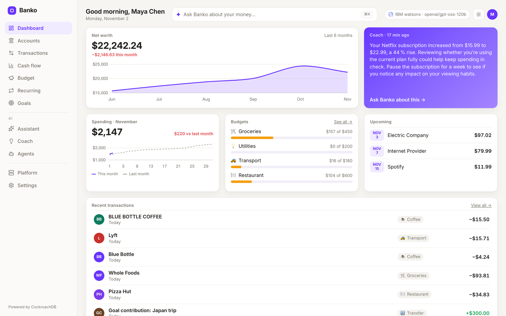
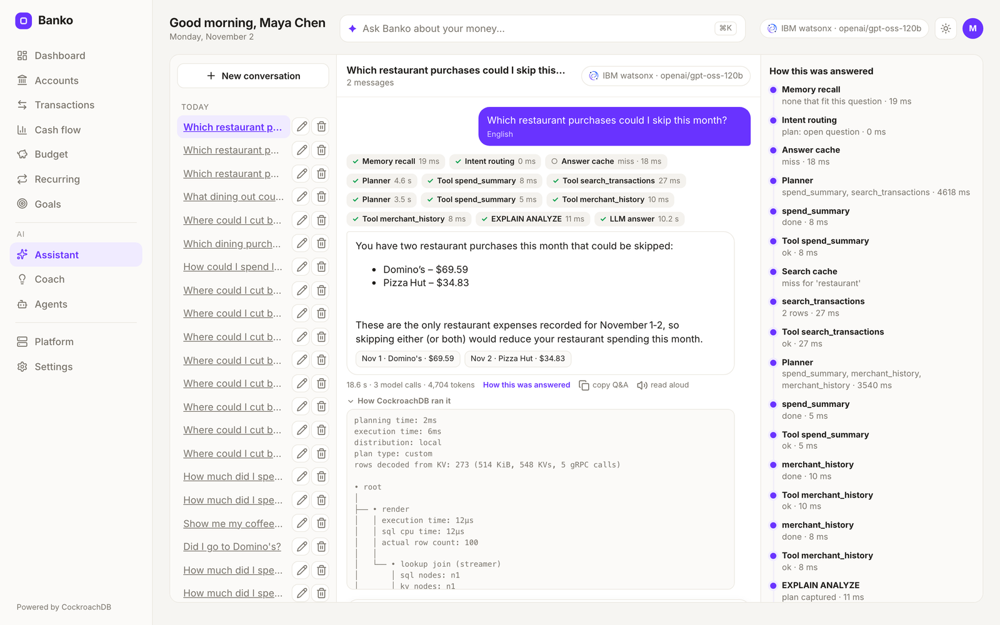
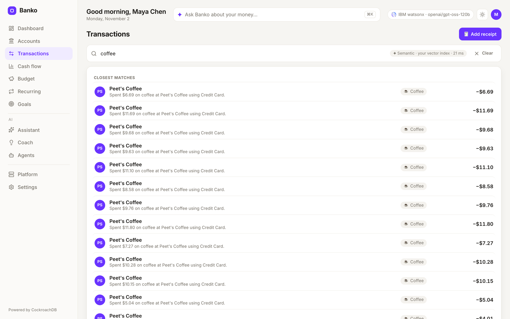
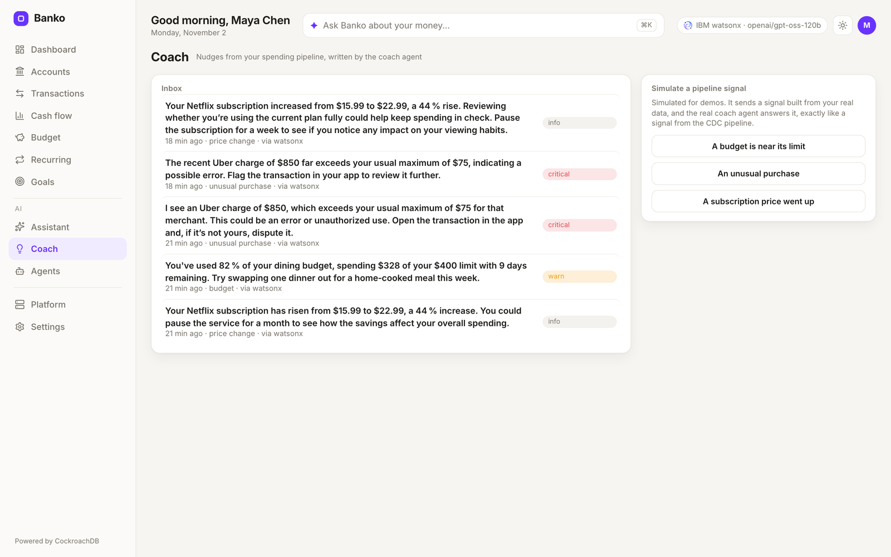
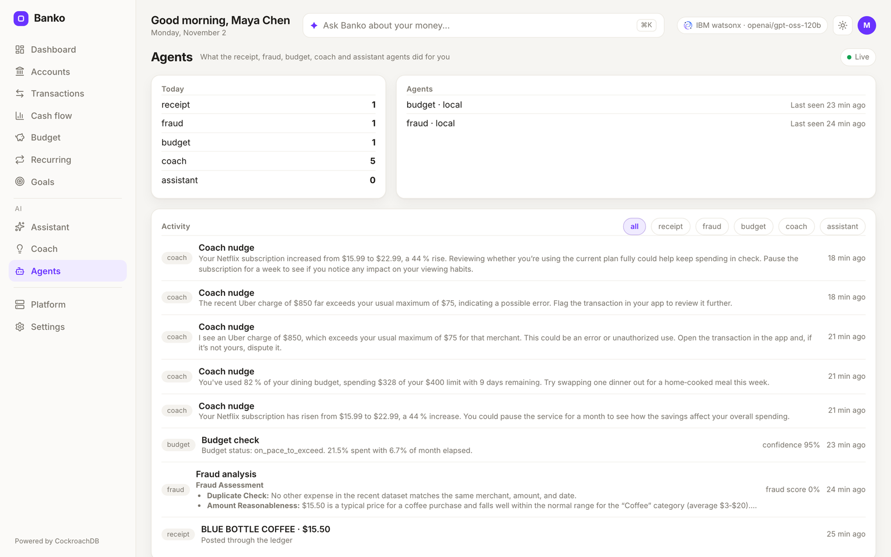
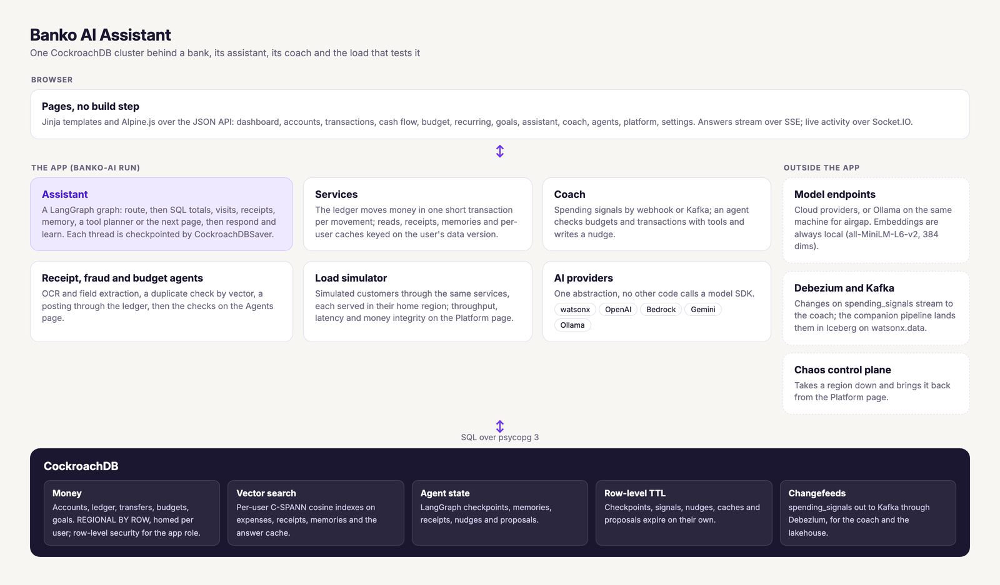

[](https://pypi.org/project/banko-ai-assistant/)
[](https://pypi.org/project/banko-ai-assistant/)
[](https://pypi.org/project/banko-ai-assistant/)
[](https://hub.docker.com/r/virag/banko-ai-assistant)

# Banko AI Assistant

A demo bank with an AI assistant, built on one CockroachDB cluster: accounts
and a ledger, per-user vector search, a LangGraph assistant checkpointed in
the database, a spending coach fed by change data capture, and a load
simulator for taking regions down while customers keep banking. It runs on
watsonx, OpenAI, AWS Bedrock, Gemini or a local Ollama model.



| Assistant | Transactions | Coach | Agents |
|---|---|---|---|
|  |  |  |  |

Every page also has a dark theme ([dashboard](https://github.com/cockroachlabs-field/banko-ai-assistant/blob/main/docs/images/dashboard-dark.png),
[assistant](https://github.com/cockroachlabs-field/banko-ai-assistant/blob/main/docs/images/assistant-dark.png), [transactions](https://github.com/cockroachlabs-field/banko-ai-assistant/blob/main/docs/images/transactions-dark.png),
[coach](https://github.com/cockroachlabs-field/banko-ai-assistant/blob/main/docs/images/coach-dark.png), [agents](https://github.com/cockroachlabs-field/banko-ai-assistant/blob/main/docs/images/agents-dark.png)).

## What it can do

- **Answer questions about your money.** Totals, averages and counts come
  from SQL and the model only narrates them, so the figures are the same on
  every provider. Visit questions ("when did I last go to Costco?") come
  straight from SQL, with no model call in English. Open questions go to a
  planner that calls tools. Answers stream, and each one shows how it was
  built: the steps, the database time and the EXPLAIN ANALYZE plan.
- **Read receipts.** Drop an image or PDF anywhere: OCR and field
  extraction, a duplicate check, a posting through the ledger, then the
  fraud and budget agents, each step shown as it finishes. Ask about the
  receipt afterwards, even after a restart.
- **Remember.** Conversations are checkpointed in CockroachDB, and the
  memories you create are searchable and deletable. Proposed changes, like
  a new budget, wait for you to confirm.
- **Coach.** Spending signals arrive by webhook or Kafka, an agent looks
  into them with real budget and transaction tools, and a nudge lands on
  the Coach page.
- **Survive a region going down.** On a multi-region cluster each user's
  rows live in their home region (REGIONAL BY ROW) and are served from
  there. The Platform page runs simulated customers through the same
  services, shows throughput, latency and money integrity live, and with
  the chaos control plane connected takes a region down from the same page.

## How it works



| Layer | What it does | Where |
|-------|--------------|-------|
| **Web** | Flask, Socket.IO and a JSON API; pages are templates plus Alpine.js, no build step | `banko_ai/web/` |
| **Assistant** | A LangGraph graph (route, SQL aggregation, visits, receipts, memory, planner), checkpointed per thread by `CockroachDBSaver` | `banko_ai/assistant/` |
| **Services** | The ledger and every read and write of money, one short transaction each | `banko_ai/services/` |
| **AI providers** | One abstraction over watsonx, OpenAI, Bedrock, Gemini and Ollama; no other code calls a model SDK | `banko_ai/ai_providers/` |
| **Vector search** | SQL on per-user C-SPANN cosine indexes with 384-dim `all-MiniLM-L6-v2` embeddings computed locally | `banko_ai/services/` |

Answers and searches are cached per user and per data version, so a new
purchase retires every cached answer it could change.

## Run it

You need Python 3.11+ (3.12 recommended), CockroachDB v25.4 or later, and
credentials for one provider or a local Ollama.

```bash
pip install banko-ai-assistant
brew install cockroachdb/tap/cockroach        # or any CockroachDB v25.4+
cockroach start-single-node --insecure --store=./cockroach-data \
  --listen-addr=localhost:26257 --http-addr=localhost:8080 --background
banko-ai doctor                                # what is ready, what is not
```

Then start it with one provider. `DATABASE_URL` defaults to the local
cluster above.

```bash
WATSONX_API_KEY=... WATSONX_PROJECT_ID=... banko-ai run         # watsonx, the default
AI_SERVICE=openai OPENAI_API_KEY=sk-... banko-ai run            # or any compatible endpoint via OPENAI_BASE_URL
AI_SERVICE=aws AWS_PROFILE=your-profile banko-ai run            # Bedrock: aws, not bedrock
AI_SERVICE=gemini GOOGLE_PROJECT_ID=... GOOGLE_API_KEY=... banko-ai run
AI_SERVICE=ollama banko-ai run                                  # local model, no keys
```

Open <http://localhost:5000>. The server listens in about two seconds and
does the slow work afterwards; pages show a getting-ready card until the
schema and the personas are in place. Sign in as `maya`, `sam` or `riley`,
or sign up with a new name to get your own seeded history in the spending
style you pick. `CDC_WEBHOOK_HMAC_SECRET=<any secret>` turns on the Coach
webhook and the welcome nudge for new users. macOS AirPlay holds port
5000, so `banko-ai run --port 5001` (or `PORT`) is often handy.

From a clone, put `uv run` in front of the same commands after `uv sync`.
With Docker, `docker compose up -d` starts CockroachDB and Banko together;
[`docs/DOCKER.md`](docs/DOCKER.md) covers the images and compose files.

### Offline

Embeddings are always local, so with Ollama nothing needs the internet:

```bash
docker compose -f docker-compose.airgap.yml up -d   # first run online to pull the model, then offline
```

`scripts/airgap/preload-models.sh` pulls the models ahead of time instead.
The default model is granite3.3:8b (`OLLAMA_MODEL`). On a Mac, native
`ollama serve` with `AI_SERVICE=ollama banko-ai run` is faster than Ollama
in Docker, which cannot use the Apple GPU.

The audience came to see watsonx and the venue has no network?
`AI_DISPLAY_PROVIDER=watsonx AI_DISPLAY_MODEL=ibm/granite-3-8b-instruct`
with `AI_SERVICE=ollama` serves from the local model while the badges say
watsonx. The terminal prints both at startup, and `/api/health` reports
the real provider under `actual`.

## Running the demo

- **Receipt follow-ups.** Drop a receipt, then ask "what was the total on
  this receipt?", "is this receipt a duplicate?" and "which merchant was
  this receipt from?". Restart the app and keep asking: the thread picks up
  where it was.
- **Exact numbers.** "How much did I spend on dining in the last 60 days?"
  shows the SQL time and the plan; switch providers and the figure stays.
- **Any language, by voice.** Pick a language in the assistant and ask out
  loud; the mic appears where the browser offers speech recognition (not
  Firefox).
- **Search by meaning.** Search transactions for "coffee" or "weekend
  treats": each user's own vector index answers.
- **Kill a region under load.** On a multi-region cluster, start load on
  the Platform page, take a region down, and watch its customers move to a
  surviving region with balances still matching their ledgers, then come
  home after the region recovers.
- **Remember something.** "Remember that I'm saving for a trip to Japan."
  Later answers draw on it, across restarts, and Settings lists it.

## Commands

| Command | What it does |
|---|---|
| `banko-ai doctor` | Database, schema, embedding model, provider, Ollama model, tesseract, port, status API and chaos plane, one line each |
| `banko-ai run` | Start the app (`--port`, `--host`, `--no-data` to skip seeding) |
| `banko-ai seed` | Seed the personas, or `--users N` new demo users |
| `banko-ai reset [names]` | Start users over (the personas by default) |
| `banko-ai migrate` | Apply the schema now instead of on the next boot |
| `banko-ai search QUERY --user NAME` | Vector search over one user's purchases |
| `banko-ai load run` | Generate banking traffic in the terminal (see below) |
| `banko-ai clear-demo-users` | Remove signed-up and generated users, keep the personas |
| `banko-ai config` | Every setting in effect and where it came from |

## Configuration

| Variable | What it does | Default |
|---|---|---|
| `DATABASE_URL` | CockroachDB connection string | `cockroachdb://root@localhost:26257/defaultdb?sslmode=disable` |
| `AI_SERVICE` | `watsonx`, `openai`, `aws`, `gemini` or `ollama` | `watsonx` |
| `RLS_MODE` | `auto` serves requests as the `banko_app` role under row-level security when it can; `off` does not | `auto` |
| `SECRET_KEY` | Session key; set it so restarts keep people signed in | random per boot |
| `CDC_WEBHOOK_HMAC_SECRET` | Signs Coach webhook posts; unset turns the webhook off | unset |
| `BRAND_NAME`, `BRAND_ACCENT` | The assistant's name and the UI accent color | `Banko`, `#6933FF` |
| `UI_THEME`, `UI_LANGUAGES` | Default theme and the assistant's languages | `system`, ten languages |
| `CATEGORIES_FILE`, `PERSONAS_FILE`, `SEED_PROFILES_FILE` | Your own YAML for categories, personas and seed profiles | packaged files |
| `SEED_HISTORY_MONTHS` | Months of history for each persona or new user | `6` |
| `CHAOS_CONTROL_URL`, `CRDB_ADMIN_URL` | The chaos control plane and the DB Console, for the Platform page | empty, derived |
| `OLLAMA_NUM_CTX`, `OLLAMA_KEEP_ALIVE` | Ollama's context window and idle unload time | `8192`, `5m` |

That is a short list. `banko-ai config --docs` prints the full reference
as Markdown, and model lists, pools, caches, the coach and the load
simulator all have their own settings there.

## Load and chaos

Open **Platform**, pick a profile (balanced, payments, browsing, search or
your own weights), the number of customers and operations per second, and
press Start load. Simulated `load-` customers spread across the database's
regions and go through the real ledger, so money integrity is checked
while it runs. Latency counts from when each operation was due, so a
struggling cluster shows as latency and dropped operations rather than
quietly less load.

On a multi-region cluster every customer is served through a node in their
home region, as a regional deployment of the app would serve them. That
needs a database URL that reaches every region, such as the chaos demo's
load balancer. For a chaos demo with realistic latency, run with
`RLS_MODE=off`: under row-level security CockroachDB 26.3 plans each
statement after a round trip to a system range. Give a freshly created
database about fifteen minutes for its leases to settle in their regions.
With `CHAOS_CONTROL_URL` set, the chaos card takes regions down and brings
them back.

```bash
banko-ai load run --profile payments --users 500 --rate 200 --duration 5m
banko-ai load start --url http://localhost:5000 --rate 200   # drives a running app
banko-ai load users clear
```

## The Spending Coach

Post a synthetic signal and watch it become a nudge on `/coach` (signed in
as maya):

```bash
export CDC_WEBHOOK_HMAC_SECRET=dev-only-secret     # same value as the app
uv run python scripts/coach/mock_signals.py --type=budget_threshold   # or anomaly, recurring_drift
```

For the real path, `scripts/coach/cdc-demo/run-cdc-demo.sh` starts Kafka
and the Debezium CockroachDB connector on the `spending_signals` table; run
the app with `COACH_KAFKA_ENABLED=true KAFKA_BOOTSTRAP_SERVERS=localhost:29092`
and an `INSERT INTO spending_signals` reaches the coach with no webhook.
`scripts/coach/assert_nudges.py` checks either transport end to end, and
[PIPELINE_CONTRACT.md](PIPELINE_CONTRACT.md) is the producer contract. The
companion repo
[`cockroachdb-watsonx-data-pipeline`](https://github.com/viragtripathi/cockroachdb-watsonx-data-pipeline)
streams the same changes into Apache Iceberg on watsonx.data.

## API

The banking data has a JSON API under `/api/v1` (dashboard, accounts and
statements, transactions and semantic search, cash flow, budgets, recurring
bills, goals, transfers with idempotency keys), scoped to the signed-in
user. `/api/health`, `/api/health/live` and `/api/health/ready` report the
app's state. Routes and examples are in [`docs/API.md`](docs/API.md).

## Upgrading from 1.3

- Python 3.11 or later.
- Point 2.0 at your existing database: the first boot adds the new tables
  and columns in place (or run `banko-ai migrate` beforehand). Existing
  rows stay.
- The driver is psycopg 3. `DATABASE_URL` takes `cockroachdb://` or
  `postgresql://` as before.
- Old setting names still work with a warning: `WATSONX_MODEL_ID`,
  `WATSONX_URL`, `AWS_MODEL_ID`, `GEMINI_API_KEY` and `CACHE_THRESHOLD`.
  Settings that no longer do anything, `SAMPLE_DATA_COUNT` among them, say
  so once at startup.
- There is no ownerless sample data any more: personas and new users get
  their own seeded history. `generate-data` and `clear-data` point to
  `banko-ai seed` and `banko-ai reset`, and `status` to `banko-ai doctor`.

## Testing

```bash
make test-local          # ruff, mypy (advisory) and pytest
```

The suite needs a CockroachDB at `DATABASE_URL`; tests that need one skip
without it. `BANKO_UI_TESTS=1 uv run pytest tests/ui` drives every page in
a real browser, and `scripts/smoke.py` checks a running app through its
provider.

## Troubleshooting

Start with `banko-ai doctor`. Beyond that: receipts that read as "Unknown"
mean tesseract is missing (`scripts/setup_system_deps.sh`), and
`/api/health?refresh=1` re-checks the provider and the database.

## License

MIT
